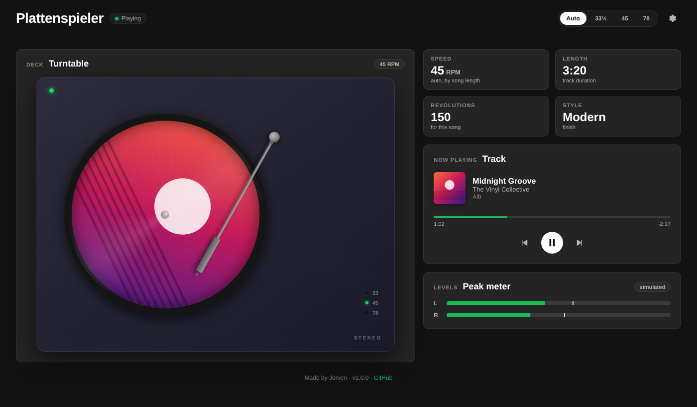
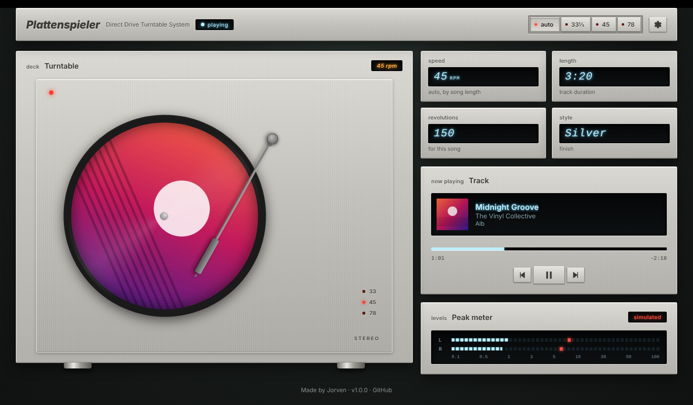
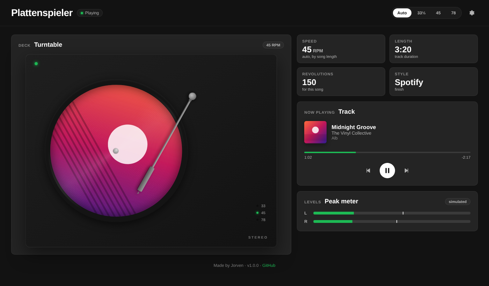
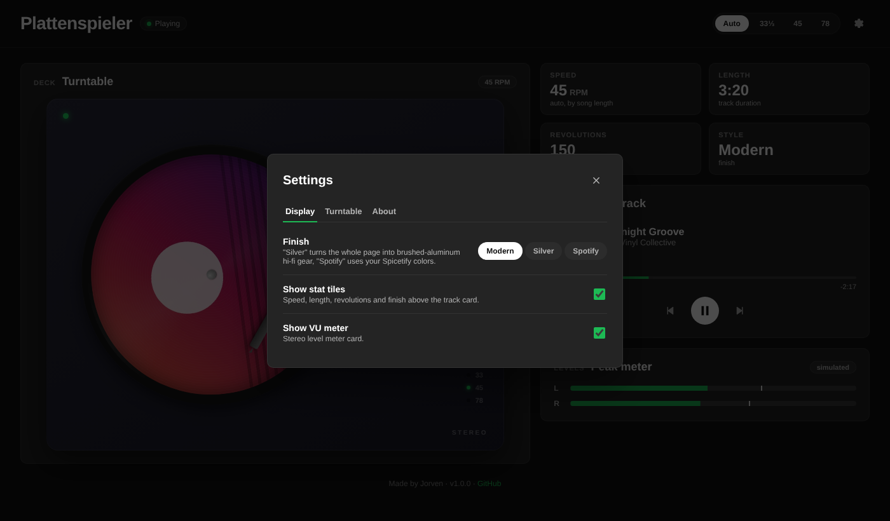

# Plattenspieler

A [Spicetify](https://spicetify.app) custom app that puts the song you are listening to on a turntable: the album art
spins as a vinyl record, the tonearm tracks the song position, and a peak meter dances along.



<table>
  <tr>
    <td></td>
    <td></td>
    <td></td>
  </tr>
  <tr>
    <td align="center">Silver finish</td>
    <td align="center">Spotify finish</td>
    <td align="center">Settings window</td>
  </tr>
</table>

## Features

- **Spinning record** with the current album art, real spin-up and spin-down like a belt-drive turntable
- **Tonearm** that glides from the outer to the inner groove as the song plays and lifts slightly while paused
- **Speed** 33⅓ / 45 / 78 RPM, automatic by song length or fixed, switchable in the header
- **Now playing card** with cover, title, artist, album, seekable progress bar and previous / play-pause / next
- **Peak meter** for the left and right channel (uses Spotify's analyser when available, otherwise a simulated signal)
- **Three finishes**
  - *Modern*: dark turntable with green LEDs in a Spotify-style layout
  - *Silver*: the whole page as brushed-aluminum hi-fi gear of the early 80s, with glowing VFD displays and bevelled keys
  - *Spotify*: follows the colors of your Spicetify theme
- **Settings window** for finish, speed, inertia, tiles, peak meter and click-to-play
- **Keyboard support**: Space/Enter on the record, arrow keys on the progress bar, Esc closes the settings
- Respects `prefers-reduced-motion`, works in narrow windows, no data leaves your computer

## Requirements

- Spotify desktop app
- [Spicetify](https://spicetify.app/docs/getting-started) installed and applied at least once

## Installation

The ready-built app is in `dist/`, so you do not need Node.js to install it.

**Linux / macOS**

```bash
git clone https://github.com/hjorven/spicetify-plattenspieler.git
APP_DIR="$(dirname "$(spicetify -c)")/CustomApps/plattenspieler"
mkdir -p "$APP_DIR"
cp spicetify-plattenspieler/dist/index.js spicetify-plattenspieler/dist/style.css spicetify-plattenspieler/dist/manifest.json "$APP_DIR/"
spicetify config custom_apps plattenspieler
spicetify apply
```

**Windows (PowerShell)**

```powershell
git clone https://github.com/hjorven/spicetify-plattenspieler.git
$AppDir = Join-Path (Split-Path (spicetify -c)) "CustomApps\plattenspieler"
New-Item -ItemType Directory -Force -Path $AppDir | Out-Null
Copy-Item spicetify-plattenspieler\dist\index.js, spicetify-plattenspieler\dist\style.css, spicetify-plattenspieler\dist\manifest.json -Destination $AppDir
spicetify config custom_apps plattenspieler
spicetify apply
```

After `spicetify apply`, Spotify restarts and **Plattenspieler** appears in the sidebar.

## Updating

```bash
cd spicetify-plattenspieler
git pull
APP_DIR="$(dirname "$(spicetify -c)")/CustomApps/plattenspieler"
cp dist/index.js dist/style.css dist/manifest.json "$APP_DIR/"
spicetify apply
```

## Uninstalling

```bash
spicetify config custom_apps plattenspieler-
rm -rf "$(dirname "$(spicetify -c)")/CustomApps/plattenspieler"
spicetify apply
```

## Troubleshooting

| Problem | What to do |
|---------|-----------|
| The app does not show up in the sidebar | Run `spicetify config custom_apps` and check that `plattenspieler` is listed, then `spicetify apply` again. |
| "Plattenspieler crashed" page | Click **Try again**. If it happens again, open an [issue](https://github.com/hjorven/spicetify-plattenspieler/issues/new/choose) and paste the error shown on the page. |
| Peak meter says "simulated" | Most Spotify versions do not expose an audio analyser. The meter then shows a beat-like signal. |
| Spotify (Flatpak) crashes with `GPU process isn't usable` | Not caused by this app. Start Spotify with `--disable-gpu`. |
| After a Spotify update the app is gone | Spotify updates remove Spicetify. Run `spicetify backup apply`. |

## Contributing

Contributions are welcome, from bug reports and ideas to code, new finishes and documentation.

- [CONTRIBUTING.md](CONTRIBUTING.md): how to report bugs, suggest features and open a pull request
- [DEVELOPMENT.md](DEVELOPMENT.md): set up the project, build, test and debug
- [ARCHITECTURE.md](ARCHITECTURE.md): how the app works inside (player, animation engine, styling)
- [TESTING.md](TESTING.md): manual test checklist for Spotify

## Privacy

The app makes no network requests of its own apart from loading cover images from Spotify's CDN. Settings are stored
in `localStorage` in your Spotify client. See [SECURITY.md](SECURITY.md).

## Credits

Layout, settings window and parts of the project setup follow patterns from
[listening-stats](https://github.com/HeadshotInteractive/listening-stats) (MIT). No code was copied verbatim.

## License

[MIT](LICENSE). See [CHANGELOG.md](CHANGELOG.md) for the release history.
